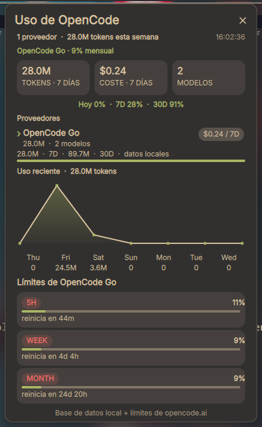

# OpenCode Usage

> [English](README.en.md) · **Español**

Plugin de [DankMaterialShell](https://danklinux.com/) que muestra tu gasto local
de [OpenCode](https://opencode.ai) en la barra y en un panel detallado: tokens y
coste de hoy, los últimos 7 días y el mes actual, gráfico de uso reciente,
proveedores, modelos y los límites de tu suscripción **OpenCode Go**.

Todo se lee en local. Sin cuenta, sin telemetría y el plugin nunca guarda tu
clave de API.

## Captura



## Características

- Indicador en la barra con los tokens de hoy (se pone rojo cuando el coste de
  hoy supera el umbral configurado).
- Panel emergente con:
  - Tarjetas de resumen: tokens (7D), coste (7D) y número de modelos.
  - Línea de reparto: hoy / 7D / 30D como porcentaje del total.
  - Desglose por proveedor con barra de progreso.
  - Gráfico de uso de los últimos 7 días con detalle por día al pasar el cursor.
  - **Límites de OpenCode Go**: rolling (5 h), semanal y mensual con porcentaje
    consumido y cuenta atrás de reinicio; junto al rolling se muestra el conteo
    local de tokens Go de las últimas 5 horas.
- Traducciones al español incluidas (`translations/es.json`).

## Requisitos

| Requisito | Para qué |
| --- | --- |
| DankMaterialShell `>= 1.5.0` | Shell anfitrión |
| `sqlite3` | Leer `opencode.db` |
| `jq` | Parsear JSON |
| `curl` | Consultar los límites de OpenCode Go |
| [OpenCode](https://opencode.ai) con uso local | Origen de los datos |

## Instalación

Copia este directorio en la carpeta de plugins de DMS:

```sh
cp -r opencodeUsage "${XDG_CONFIG_HOME:-$HOME/.config}/DankMaterialShell/plugins/"
```

Después abre **DankMaterialShell Settings → Plugins** y activa **OpenCode Usage**.
Añade el widget a una barra desde la configuración de barras.

## Fuentes de datos

El plugin lee dos archivos locales, ambos del CLI de OpenCode:

| Dato | Origen |
| --- | --- |
| Tokens, coste, gráfico, proveedores, modelos | `~/.local/share/opencode/opencode.db` (solo lectura) |
| Límites de OpenCode Go | `~/.local/share/opencode/auth.json` → `https://opencode.ai/zen/go/v1/usage` |

- La base de datos se abre en modo solo lectura y nunca se modifica.
- Las ventanas se calculan con el timestamp de cada mensaje del asistente, así
  que una sesión que dura varios días se atribuye al día en que se gastaron los
  tokens.
- Se incluyen los tokens de caché (lectura y escritura) en los totales.
- La clave de API se lee en cada consulta y se pasa mediante un archivo temporal
  con permisos `0600` que se elimina de inmediato. Nunca se registra, se guarda
  ni se sube al repositorio.

Puedes cambiar el directorio de datos con `OPENCODE_DATA_DIR` si tu instalación
de OpenCode está en otro sitio.

## Funcionamiento

```text
opencode CLI ──► opencode.db ──┐
                               ├──► fetch-usage.sh ──JSON──► estado del plugin ──► widget
auth.json ──► API de opencode.ai ─┘
```

1. El daemon ejecuta `fetch-usage.sh` cada `refreshInterval` segundos.
2. El script consulta la base de datos y (si hay clave) el endpoint de uso de
   OpenCode Go, y escribe un único objeto JSON en el estado del plugin.
3. El widget dibuja ese estado. Si no hay clave o no hay red, cae en los datos
   locales y muestra `No API key`.

## Ajustes

| Ajuste | Por defecto | Descripción |
| --- | --- | --- |
| Refresh Interval | `60` | Cada cuánto releer la base de datos (15–300 s) |
| Show Tokens | `true` | Mostrar conteos de tokens de entrada/salida/razonamiento/caché |
| Show Session Count | `true` | Mostrar el número de sesiones por ventana |
| Daily Cost Alert | `0` | Poner el indicador en rojo cuando el coste de hoy llegue a este monto (`0` desactiva) |

## Traducciones

Los textos de la interfaz viven en `translations/<locale>.json`. El inglés es el
fallback integrado; se incluye español. Se aceptan contribuciones.

## Privacidad

- Ningún dato sale de tu equipo, salvo la consulta a `opencode.ai` para tus
  propios límites de suscripción, autenticada con tu propia clave.
- El plugin no incrusta, transmite ni persiste ninguna credencial.

## Changelog

Ver [CHANGELOG.md](CHANGELOG.md).

## Licencia

MIT — ver [LICENSE](LICENSE).

## Autor

Daniel Ferrada.
